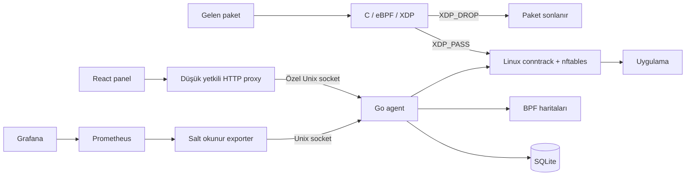
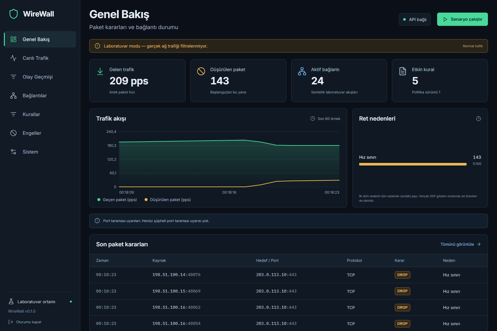
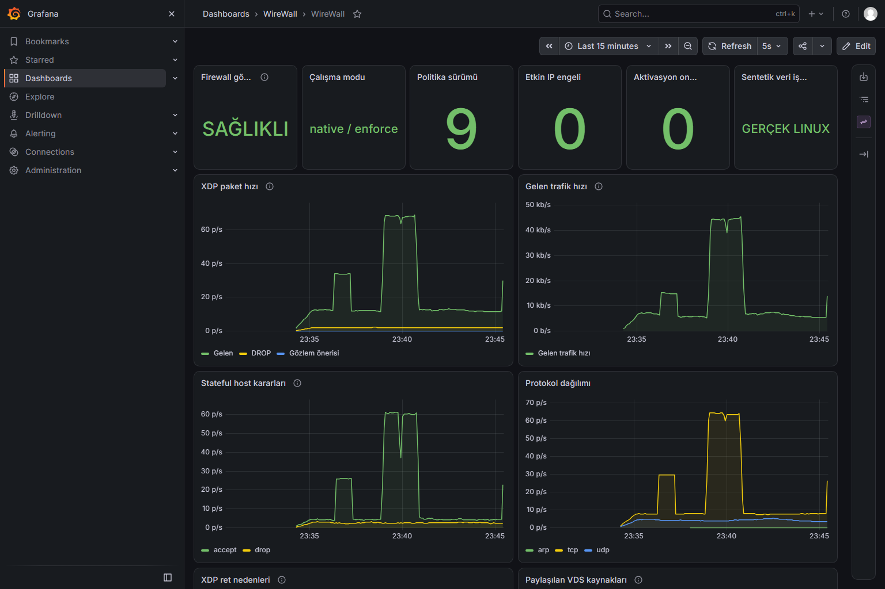

# WireWall

**Ubuntu için eBPF/XDP + nftables tabanlı Layer 4 güvenlik duvarı.** Türkçe yönetim paneli, bağlantı gözlemi, kalıcı olay raporları ve Grafana izleme.


Siber Saldırı ve Savunma Yöntemleri 2 dersinin final projesi olarak geliştirildi. C ile yazılan XDP programı paketi erken sınıflandırır; Linux conntrack/nftables bağlantı durumunu ve host giriş politikasını uygular. Go kontrol düzlemi ile React paneli bu katmanları yönetir.

[Hızlı başlangıç](#hızlı-başlangıç-laboratuvar) · [Ubuntu kurulumu](docs/INSTALL-REMOVE.md) · [API](docs/API.md) · [Test sonuçları](docs/TESTING.md) · [Sunum](docs/presentation/WireWall-Final.pptx)

## Neler yapar?

| Alan | Özellik |
|---|---|
| Erken filtre | IPv4/temel IPv6, en fazla iki VLAN, TCP/UDP/ICMP, IP/CIDR ve port eşleştirme |
| Kurallar | En fazla 64 sıralı kural, alanlar AND, ilk etkin eşleşme, pass/drop/limit |
| Hız kontrolü | Toplam ve kaynak başına paket/byte token bucket, SYN koşulu, burst |
| Süreli engel | Tek IP için TTL, kernel tarafında son kullanım kontrolü, en fazla 4.096 aktif engel |
| Stateful host | Conntrack established/related, dar yönetim SSH istisnası, izinli servisler, varsayılan ret |
| Güvenli değişiklik | Sürüm kontrolü, bağımsız 90 saniyelik geri alma, yeni SSH sonrası operatör onayı |
| Panel | Genel Bakış, Canlı Trafik, Olay Geçmişi, Bağlantılar, Kurallar, Engeller, Sistem |
| Geçmiş ve rapor | 30 gün/100.000 örnek kayıt, filtreler, cursor sayfalama, özetler, CSV/JSON/HTML |
| İzleme | Gerçek paket/protokol/hedef port ve nft sayaçları, CPU/RAM/conntrack, Prometheus, 19 Grafana paneli |
| Uyarı | Sınırlı tablolarla şüpheli TCP port taraması gözlemi; otomatik ban uygulamaz |

## Mimari



XDP_PASS, uygulamaya kesin kabul anlamına gelmez; paket Linux ağ yığınına geçer. Stateful karar Linux conntrack/nftables içindedir. ACK bayrağı tek başına bağlantı doğrulaması olarak kullanılmaz.

Agent TCP yönetim portu açmaz. Root agent ile düşük yetkili web süreci izinleri sınırlı Unix socket üzerinden konuşur. Panel ve izleme HTTP servisleri yalnız loopback'te dinler; uzaktan SSH tüneliyle kullanılır. SQLite ve panel, XDP paket karar yolunda çalışmaz.

## Kullanılan teknolojiler

| Teknoloji | Kullanım |
|---|---|
| C, eBPF/XDP, Linux UAPI/libbpf başlıkları | Sınır kontrollü parser, erken ACL, bucket ve per-CPU sayaçlar |
| Go 1.26+, cilium/ebpf | Loader, map-in-map politika geçişi, agent, watchdog, HTTP/Unix API |
| nftables, Linux conntrack | Host-input stateful politikası ve gerçek bağlantı gözlemi |
| SQLite, modernc.org/sqlite | CGo gerektirmeyen politika, ban, audit ve olay kalıcılığı |
| React 19, TypeScript 5.9, Vite 7 | Türkçe panel, SSE ve HTTP polling, mobil görünüm |
| Prometheus, Grafana OSS | Zaman serisi, datasource/dashboard provisioning |
| Go test/vet, Playwright, Python/Bash | Kod, panel, kernel/namespace ve kontrollü ağ deneyleri |

Tam sürümler `go.mod`, `go.sum` ve `web/package-lock.json` içindedir. Üçüncü taraf bildirimleri [bağımlılık envanterinde](docs/DEPENDENCIES.md) korunur.

## Hızlı başlangıç: laboratuvar

Windows veya Linux'ta Go 1.26+, Node.js 22.12+ ve npm gerekir. Node.js 24 de uygundur. Bu mod root gerektirmez; gerçek ağ paketi üretmez ve bilgisayarınızı korumaz.

```bash
git clone https://github.com/TheDarkGuardian/WireWall.git
cd WireWall
npm --prefix web ci
npm --prefix web run build
go run ./cmd/wirewall serve --backend lab --policy deploy/policy.lab.json
```

**Panel:** http://127.0.0.1:8080/ . İlk başlangıçta oluşturulan `data/operator.token` dosyasını kendi bilgisayarınızda açıp içindeki anahtarla giriş yapın. Dosyayı paylaşmayın veya Git'e eklemeyin. Oturum anahtarı tarayıcı localStorage/sessionStorage alanlarına yazılmaz.

Go PATH'te yoksa `python scripts/dev/bootstrap_go.py` resmi arşivin SHA256 değerini doğrulayıp `.tools/go` altına taşınabilir kurulum yapar. Windows'ta `go` yerine `.\.tools\go\bin\go.exe` kullanılabilir. Başlangıç politikası beş örnek kural içerir. Panelde `normal`, `syn-burst`, `udp-burst`, `port-scan`, `mixed` senaryoları vardır; bunlar sentetik paket açıklamalarını değerlendirir.

Panel değişiklikleri SQLite'ta kalır. Sonraki başlangıçlarda JSON dosyası kayıtlı politikanın üzerine yazmaz. Bilerek yeniden yüklemek için `--replace-policy` gerekir.



*Ekran görüntüsü sentetik laboratuvardır. LAB_FLOW satırları gerçek TCP bağlantısı veya saldırı kanıtı değildir.*

## Gerçek Ubuntu / XDP kurulumu

Test edilen ortam Ubuntu 22.04.5 LTS, Linux 5.15, x86_64 KVM ve virtio_net sürücüsüdür. Root yetkisi, kernel BTF/eBPF desteği ve seçilen sürücünün XDP desteği gerekir. Native desteklenmezse açıkça generic seçilir; program sessizce mod değiştirmez.

Kaynakları arayüze bağlamadan derleyin:

```bash
sudo apt-get update
sudo apt-get install -y clang llvm gcc libbpf-dev linux-libc-dev iproute2 nftables conntrack python3 curl ethtool
npm --prefix web ci
npm --prefix web run build
bash scripts/linux/build.sh
go test -count=1 ./...
go vet ./...
sudo -E bash scripts/linux/test-kernel.sh
sudo -E bash scripts/linux/test-netns.sh
sudo -E bash scripts/linux/test-recovery.sh
```

Kernel/namespace kapıları geçmeden dış arayüze bağlamayın. `deploy/policy.example.json` içindeki **arayüzü, yönetim CIDR'ini ve SSH portunu** kendi ortamınıza göre düzenleyin; örnek `192.0.2.10/32` gerçek yönetim adresiniz değildir. İlk politika `observe` modundadır. Observe yalnız XDP erken ret önerilerini uygulamaz; nft host politikası yürürlükte kalır.

[Tam kurulum/güncelleme/kaldırma rehberi](docs/INSTALL-REMOVE.md) dosya izinlerini, systemd kullanıcılarını ve ilk aktivasyonu açıklar. Normal dağıtım iki süreçtir:

```text
wirewall agent                  root, XDP/nftables, özel Unix socket
wirewall serve --backend remote  düşük yetkili panel, loopback HTTP
```

Agent ve web unit'leri `deploy/wirewall.service`, `deploy/wirewall-web.service` içindedir. Kurulum kökü `/opt/wirewall`, root state `/var/lib/wirewall`, web state `/var/lib/wirewall-web`, socket `/run/wirewall/control.sock` olur.

### SSH tüneli ve aktivasyon

```bash
ssh -N -o ExitOnForwardFailure=yes \
  -L 127.0.0.1:9880:127.0.0.1:9876 \
  -L 127.0.0.1:9881:127.0.0.1:3000 KULLANICI@SUNUCU_IP
```

Panel http://127.0.0.1:9880/ adresindedir. İlk/yeni dağıtım veya ağ politikası değişikliği **90 saniyelik bağımsız rollback** başlatır. **Yeni, multiplex kullanmayan SSH bağlantısı açın**, bağlı arayüz/mod/sağlığı doğrulayın, ardından panelden onaylayın. Açık kalan eski SSH veya tek başına HTTP health yeterli değildir. Onay gelmezse yalnız projeye ait önceki nft/BPF/SQLite durumu geri alınır.

`--resume-confirmed`, yalnız aynı onaylı politika/bans, NIC MAC/IP ve binary/BPF hash eşleşirse restart'ın önceki onayı sürdürmesine izin verir. Yeni veya pending değişikliği otomatik onaylamaz. Proje başka nft tablolarını veya BPF programlarını kaldırmaz; `flush ruleset` kullanılmaz.

## Kural davranışı

Kurallar artan öncelikle değerlendirilir, etkin alanlar AND ile eşleşir ve ilk eşleşme uygulanır. Kaynak/hedef CIDR, protokol, port/aralık, IP paket uzunluğu ve TCP SYN koşulu kullanılabilir. `pass`, sonraki host politikasını atlamaz.

```json
{
  "id": "https-syn-budget",
  "name": "HTTPS SYN başlangıç bütçesi",
  "enabled": true,
  "priority": 10,
  "action": "limit",
  "protocol": "tcp",
  "source": "any", "destination": "any",
  "sourcePort": "any", "destinationPort": "443",
  "minPacketBytes": 0, "maxPacketBytes": 0,
  "pps": 2000, "burst": 4000,
  "sourcePps": 20, "sourceBurst": 40,
  "tcpFlags": "syn"
}
```

Bu bir kural parçasıdır; tam politika örneği `deploy/policy.example.json` içindedir. Limit kuralında toplam `pps/burst` zorunludur. Byte bütçeleri `bps/byteBurst` ve `sourceBps/sourceByteBurst` ile isteğe bağlı eklenir. **Kuraldaki bps byte/s, trafik metriğindeki bps bit/s'dir.** Kaynak tablosu kapasitesinde toplam bütçe korunur ve fallback sayacı artar. Engeller panelden tek IP ve 1–86.400 saniye TTL ile eklenir; yönetim adresleri korunur.

## Olay geçmişi ve raporlar

Olay Geçmişi tarih, kaynak/hedef IP, karar, protokol, hedef port, kural, politika sürümü, neden ve metin arama filtreleri sağlar. Cursor sayfalama aynı sorgu kesim zamanını korur. Özetler sayfadaki 50 satırın değil, **bütün filtre eşleşmelerinin** sonucudur.

- SQLite: en çok 30 gün veya 100.000 global örnek olay, 5.000 audit kaydı.
- CSV/JSON: en çok 10.000 satır; kesilme API ve panelde açıkça belirtilir.
- HTML: bütün filtre özetleri ve görüntülenen sayfanın kayıtları; tarayıcıdan PDF yazdırılabilir.
- CSV formül hücreleri nötralize edilir, HTML metinleri escape edilir.

Gerçek mod olayları 1/64 örnekleme ve 64 olay/s bütçesiyle sınırlıdır. Olay sayısı tam paket, bağlantı veya doğrulanmış saldırı sayısı değildir. Paket/protokol sayaçları ise örneklenmez. XDP ve sonraki nft kabul/ret sayaçları farklı katmanlardır; birbirine eklenmez.

## Prometheus ve Grafana

`wirewall metrics --socket /run/wirewall/control.sock --listen 127.0.0.1:9878` salt okunur exporter çalıştırır. `deploy/wirewall-metrics.service`, `deploy/wirewall-prometheus.service` ve `deploy/monitoring/` dosyaları kullanılır. [İzleme kurulum rehberi](docs/MONITORING.md) ayrı kullanıcıları, resmi paket/SHA256 doğrulamasını ve secrets dosyalarını açıklar.

| Servis | VDS'de dinleme | Görev |
|---|---|---|
| WireWall panel | 127.0.0.1:9876 | Yönetim arayüzü |
| Exporter | 127.0.0.1:9878 | Salt okunur Prometheus metrikleri |
| Prometheus | 127.0.0.1:9090 | 5 saniyede scrape, 30 gün/2 GB saklama |
| Grafana | 127.0.0.1:3000 | Provision edilen 19 panel |

Grafana tünelden **http://localhost:9881/d/wirewall-l4/wirewall** adresinde açılır. WireWall'da `127.0.0.1`, Grafana'da `localhost` kullanılır; cookie'ler portla ayrılmadığı için hostname'ler bilerek ayrıdır. Grafana anonim erişimi kapalıdır, parola kurulumda özel dosyada üretilir. **Depoda hazır parola yoktur.**

Exporter eski/kopuk gözlemi sağlıklı göstermez: gözlem 10 saniyeyi aşarsa `wirewall_up=0` ve stale sayaçlar çıkarılır. Dashboard ayrıca Prometheus scrape `up` durumuna bakar. Kaynak IP ve kural kimliği metrik label'larına eklenmez.



*Bu görüntü gerçek native/enforce Linux test ortamına aittir. Sayaç geçmişi kurulumdan itibaren oluşur.*

## Geliştirme ve test

```bash
go test -count=1 ./...
go vet ./...
npm --prefix web run build
python scripts/dev/test_bench_traffic.py
```

Panelin uçtan uca testleri için:

```bash
npm --prefix web exec playwright install chromium
python scripts/dev/run_e2e.py
```

E2E helper ayrı geçici lab, rastgele test anahtarı ve boş yerel port açar; mevcut VDS/lab politikanızı değiştirmez. Linux'ta Chromium sistem bağımlılıkları yoksa Playwright'ın `install --with-deps chromium` seçeneği kullanılır. CI Go test/vet, Linux BPF derleme/ABI, web build ve panel akışlarını kontrol eder. Gerçek uplink/kernel kabulü otomatik CI sonucu diye etiketlenmez.

### Doğrulanmış sonuçlar

30 Ekim 2026'da gerçek Ubuntu ortamında kernel paket korpusu, namespace servis/guard testleri, native attach, servis restart ve gerçek reboot/yeni SSH geçti. İzole ağda **120 karşılaştırma run'ı** ve aynı native örnekte **5 dakika süreklilik** tamamlandı. Ayrı laboratuvarda **13 Playwright testi** geçti.

Ek 20-run 64 byte/1 kural karşılaştırmasında p95 RTT medyanları baseline **0,057316 ms**, nft **0,064611 ms**, generic **0,064282 ms**, native **0,066835 ms** oldu. Filtreli modlarda meşru echo %100, yasak arka plan %0. Bu sabit düşük yükte native hız üstünlüğü gösterilmedi. Veth/namespace sonucu fiziksel NIC, Mpps veya upstream DDoS kapasitesi değildir. [Yöntem, bütün sonuçlar ve sınırlar](docs/TESTING.md).

## Proje dizinleri

```text
bpf/                     C veri yolu ve ortak ABI
cmd/wirewall/            CLI, agent, web, metrics komutları
internal/control/        Politika, SQLite, HTTP, proxy, guard, history, exporter
internal/dataplane/      Linux loader, haritalar, kernel testleri
internal/hostfirewall/    nftables render/sayaç ve conntrack gözlemi
internal/policy/          Validator ve sentetik evaluator
internal/detection/       Sınırlı port taraması gözlemi
web/                     React/TypeScript panel ve Playwright testleri
deploy/                  Örnek politika, systemd, monitoring provisioning
scripts/                 Derleme, test ve benchmark araçları
docs/                    API, kurulum, izleme, test ve sunum
```

## Bilinen sınırlar

Giriş yönünde L4 host korumasıdır. L7 içerik denetimi, çıkış/forward filtresi, NAT/router/bridge, SYN proxy, PCAP, GeoIP, otomatik ban ve RBAC içermez. Fragment, IPv4 options ve çözümlenmeyen IPv6 extension/jumbogram yolları enforce modunda düşürülür. Normal IPv6 TCP/UDP ve temel ICMPv6/ND ele alınır; global IPv6 WAN kabulü ve gerçek ARM64 kernel testi yapılmadı. ARM64 cross-build yalnız derleme kanıtıdır.

Hedef port sayacı portta bir uygulama çalıştığını kanıtlamaz. Servis istatistik haritası 1.024 protokol/port anahtarıyla sınırlıdır; taşma ayrıca sayılır. Conntrack görünümü en fazla 256 satırdır, accounting kapalıysa byte/paket alanları kullanılamaz gösterilir. XDP sayaçları program yeniden yüklendiğinde, nft sayaçları tablo uygulandığında sıfırlanır.

VDS içindeki firewall sağlayıcının dolmuş upstream hattını açamaz. Native XDP, NIC donanım offload'u değildir. Beş dakikalık soak günler süren dayanıklılık garantisi değildir.

## Belgeler ve lisans bildirimleri

- [Kurulum, güncelleme, kaldırma ve kurtarma](docs/INSTALL-REMOVE.md)
- [Linux/BPF doğrulama ayrıntıları](docs/LINUX.md)
- [HTTP API ve metrik sözleşmesi](docs/API.md)
- [Prometheus/Grafana kurulumu ve işletimi](docs/MONITORING.md)
- [Test yöntemi ve sonuçlar](docs/TESTING.md)
- [Bağımlılık sürümleri ve üçüncü taraf bildirimleri](docs/DEPENDENCIES.md)
- [Düzenlenebilir final sunumu](docs/presentation/WireWall-Final.pptx) ve [PDF görünümü](docs/presentation/WireWall-Final.pdf)
- [Türkçe proje raporu](docs/presentation/WireWall-Proje-Raporu.pdf)
- [Sunumda ve araştırmada kullanılan kaynaklar](docs/presentation/WireWall-Kaynaklar.md)

WireWall’ın özgün kaynak kodu [MIT lisansı](LICENSE) ile yayımlanır. BPF kaynaklarındaki `GPL-2.0-only OR MIT` çift lisans bildirimi ve üçüncü taraf bileşenlerin kendi lisansları korunur. Grafana, Prometheus, Go SDK ve node_modules bu depoda dağıtılmaz. Özel anahtarlar, canlı state, operatör notları ve VDS bağlantı bilgileri kaynak deponun parçası değildir.
